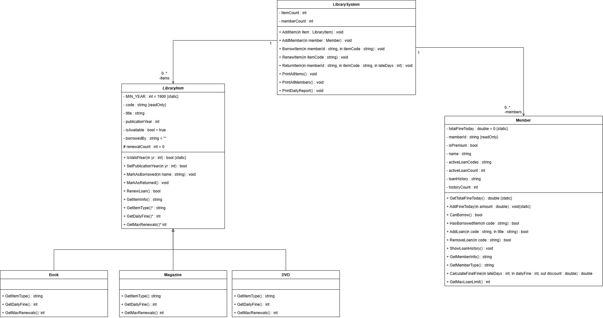

# Practice-OOP-Perpustakaan

Proyek latihan Object-Oriented Programming (OOP) berbasis C# / .NET.

## Struktur Project

## Class Diagram


## Cara Menjalankan Project

### 1. Clone Repository
```bash
git clone https://github.com/FathanMuhammad/Practice-OOP-Perpustakaan.git
cd Practice-OOP-Perpustakaan
```

### 2. Membuka Solution
- **Visual Studio 2022 (v17.10+)**: Double-click `Practice-OOP-Perpustakaan.slnx` atau buka via `File -> Open -> Project/Solution`.
- **VS Code**: Buka folder root `Practice-OOP-Perpustakaan` dengan extension *C# Dev Kit* terinstall.

### 3. Build & Run via CLI
```bash
dotnet restore
dotnet build
dotnet run --project Perpustakaan
```
